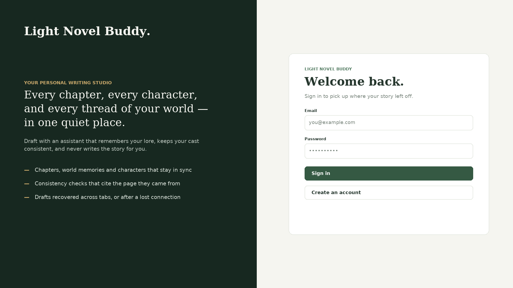
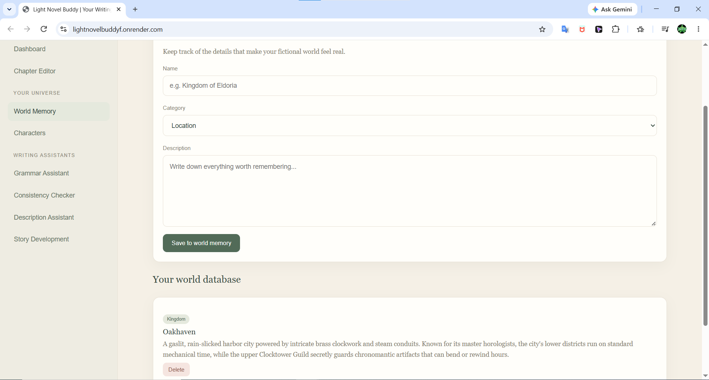
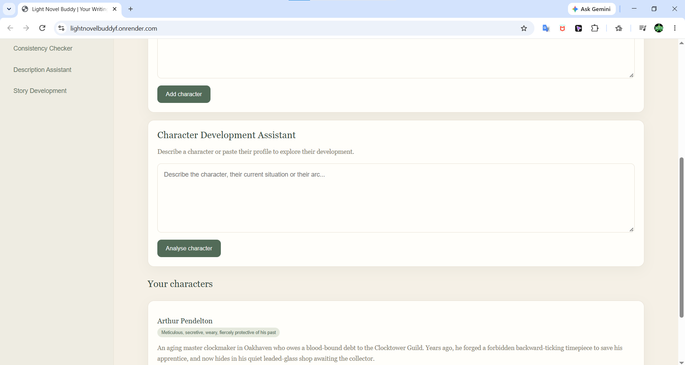
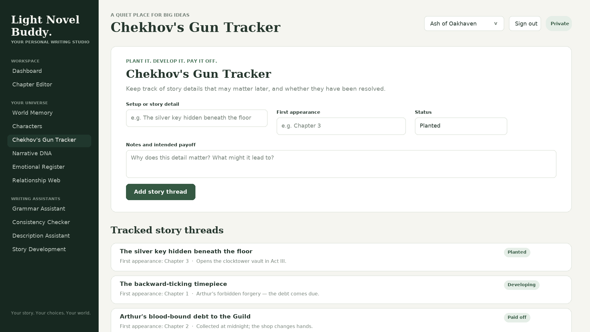
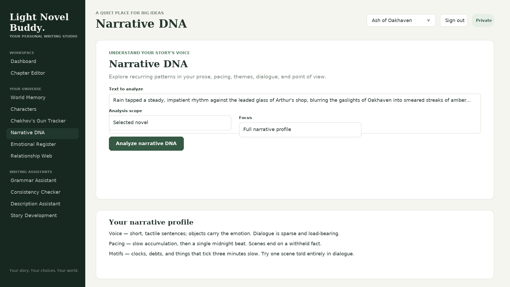
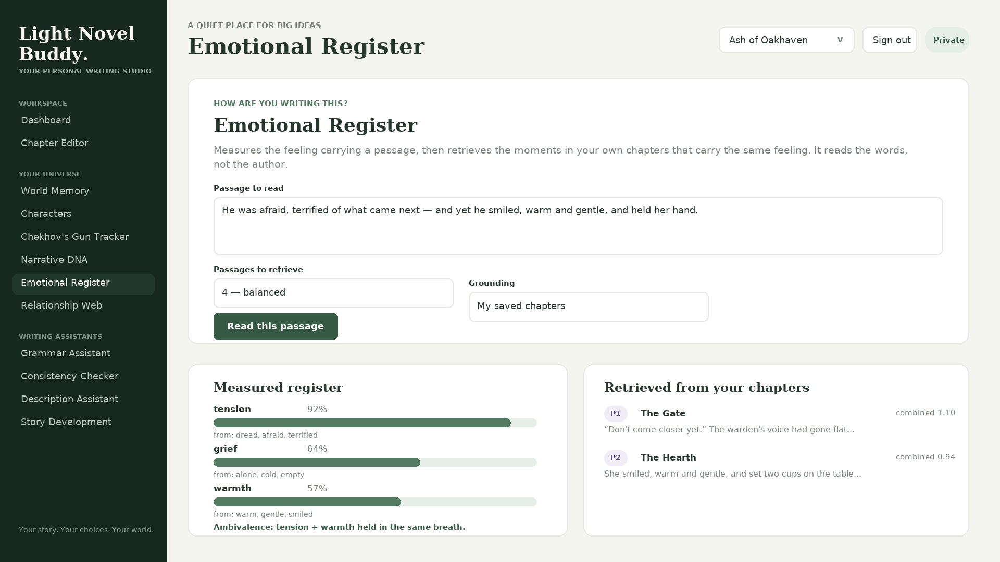
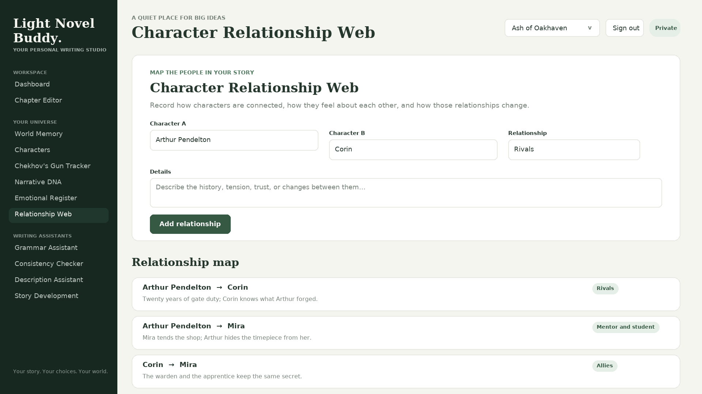
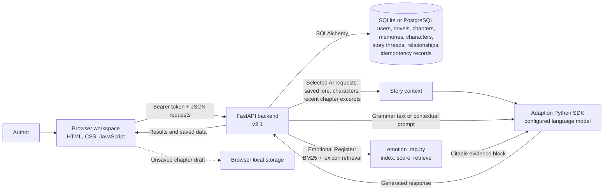
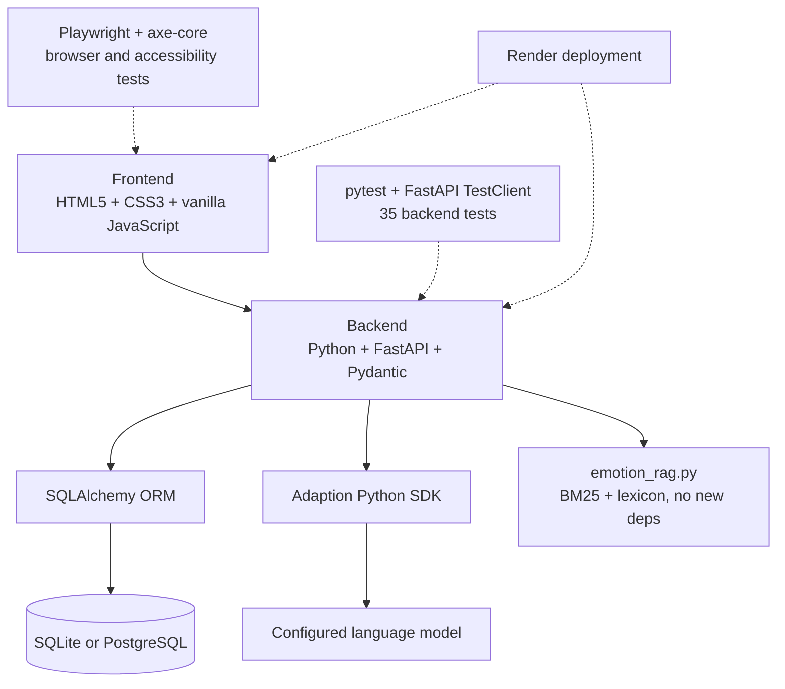

<div align="center">

# Light Novel Buddy

### Your story. Your choices. Your world.

A personal writing studio for building fictional worlds, developing characters, and exploring stories with AI assistance.<br>
Built to support the author's imagination — not take it over.

> 🏆 **Top 10 Finalist** — Light Novel Buddy finished in the **top 10 of 250 teams** (1,500+ participants) at the hackathon.

[](https://github.com/ramrounakmukherjee-blip/LightNovelBuddy)
[](https://github.com/ramrounakmukherjee-blip/LightNovelBuddy)
[](#what-shipped-the-21-november-roadmap)
[](https://lightnovelbuddyf.onrender.com/)
[](https://lightnovelbuddy.onrender.com/)
[](https://www.youtube.com/watch?v=BRy7R7-objw)


[](https://pypi.org/project/adaption/)
[](LICENSE)

**Team:** Hackholics  |  **Track:** Track-1: Storytelling & Co-writers<br>
**The problem:** Writers need a way to keep growing fictional worlds coherent without giving up their creative voice.

</div>

---

## Table of contents

- [The problem](#the-problem)
- [About the project](#about-the-project)
- [What shipped: the 21 November roadmap](#what-shipped-the-21-november-roadmap)
- [Key features and screenshots](#key-features-and-screenshots)
- [System architecture](#system-architecture)
- [Emotional Register (RAG) deep dive](#emotional-register-rag-deep-dive)
- [Adaption AI integration](#adaption-ai-integration)
- [Technology stack](#technology-stack)
- [Repository structure](#repository-structure)
- [Getting started](#getting-started)
- [Testing](#testing)
- [Future work](#future-work)
- [Impact](#impact)
- [Meet Hackholics](#meet-hackholics)
- [License](#license)

## The problem

A long-running novel can hold hundreds of details: a character's motivation, a promise made in an early chapter, the geography of a city, or the rules behind a magical ability. As the story grows, those details are easy to lose across drafts, notes, and separate writing tools. Revising prose and finding the next direction can become just as demanding as keeping the world consistent.

Generic writing tools may help polish a paragraph but lack the story context that makes a suggestion useful. At the same time, authors should not have to hand creative control to an AI. They need a companion that helps them **organise, review, and brainstorm**, while leaving the final decisions to them.

## About the project

**Light Novel Buddy** is a complete, private writing studio: a chapter editor, a world-building notebook, a character library, a story-thread tracker, a relationship map, and a suite of AI assistants — all behind sign-in, with every novel, chapter, and memory owned by its author.

Authors record the foundations of their universe, work on chapters, and ask for help with grammar, continuity, description, plot possibilities, character development, narrative voice, and emotional register. The project follows a simple principle: **AI suggests; the author decides.**

The project fits the **Wildcard — Open Innovation** track through its focus on an artistic, real-world problem: helping storytellers manage narrative complexity and explore creative possibilities.

> **Current stage:** Light Novel Buddy is a **complete, shipped product** — not a prototype. Authentication, per-user privacy, multi-novel workspaces, and the full 21 November roadmap are implemented and live. See [What shipped](#what-shipped-the-21-november-roadmap) for the item-by-item record.

## What shipped: the 21 November roadmap

The 21 November roadmap is **done**. Every major feature on it shipped, along with the Emotional Register (retrieval-augmented generation) that grew out of the judges' questions about RAG. The table below is the honest record: what shipped, where it lives, and the few refinements that remain future work.

| Roadmap item | Status | Where it lives |
| --- | --- | --- |
| **User sign-in and data privacy** | ✅ Shipped | `backend/auth.py` — JWT (HS256), PBKDF2 password hashing, `/api/auth/register`, `/api/auth/login`, `/api/auth/me`. Every data and AI route requires a bearer token and enforces novel ownership. Frontend: `auth.js` + the sign-in screen in `index.html`. |
| **Novel selection** | ✅ Shipped | `backend/novels.py` — full CRUD at `/api/novels`. The top bar picker and *New novel* button switch workspaces; chapters, memories, characters, threads, relationships, and AI context are all scoped to the selected novel. |
| **Narrative DNA** | ✅ Shipped | `POST /api/ai/narrative-dna` — analyses an excerpt or the whole selected novel for voice, pacing, themes, dialogue, and point of view, with focus options (full profile, style, pacing, themes). |
| **Chekhov's Gun Tracker** | ✅ Shipped | `StoryThread` model + `/api/chekhov` CRUD. Track setups and promises with first appearance, status (*Planted / Developing / Paid off / Abandoned*), and intended-payoff notes. |
| **Character Relationship Web** | ✅ Shipped | `CharacterRelationship` model + `/api/relationships`. Map friendships, rivalries, alliances, and secrets between characters in the selected novel, with notes on how bonds change. |
| **Emotional Register (RAG)** | ✅ Shipped — beyond the roadmap | `backend/emotion_rag.py` + `POST /api/ai/emotion-rag`. Measures a passage's emotional register locally, retrieves matching passages from the author's own chapters (BM25 + emotional affinity), and grounds the AI reading in citable evidence. See the [deep dive](#emotional-register-rag-deep-dive). |
| **Interactive story brainstorming** | ✅ Shipped | After four directions are explored, authors can tick the ones worth developing, answer follow-up questions, ask for a deeper set, or combine several into one — reusing the same endpoint via the `direction` field. |
| **Cross-tab draft recovery** | ✅ Shipped | Per-chapter draft slots with a per-tab writer id; same-draft collisions surface a conflict banner instead of silently overwriting. |
| **Local API configuration** | ✅ Shipped | `config.js` resolves the API base (query parameter, local override file, or browser storage) — no hard-coded URL edits. |
| **Consistency reference citations** | ✅ Shipped | Consistency responses cite tagged saved entries (`[W12]`, `[C3]`, `[CH5]`); the backend resolves tags against the records actually sent and renders source chips. Invented tags are dropped. |
| **Server-side validation** | ✅ Shipped | Blank/null input rejected with `422` across creates and updates; partial updates preserve untouched fields. |
| **Safe retries (idempotency)** | ✅ Shipped | `Idempotency-Key` header on creates/updates; retried requests return the original row instead of duplicating. Records expire after 7 days. |
| **Mobile & accessibility testing** | ✅ Shipped | 12 Playwright tests including axe-core checks on every section, mobile navigation, and keyboard flows. |
| **PostgreSQL via `DATABASE_URL`** | ✅ Shipped | Any SQLAlchemy URL works (`postgres://` is rewritten to `postgresql://`); `psycopg` is in `requirements.txt`. Schema migrations and backups remain future work (see [Future work](#future-work)). |
| **Automatic world extraction from chapters** | ⬜ Future | World entries are still added manually; mining chapters for facts with author review is the next major feature. |
| **Per-correction accept/reject** | ⬜ Future | Grammar feedback returns a revised passage plus a correction list; individual accept/reject controls are planned. |
| **Cross-device draft sync** | ⬜ Future | Draft recovery is per-browser (local storage). Syncing drafts across devices would build on the now-shipped sign-in. |

AI suggestions are generated responses, not guaranteed facts. Authors should review them against their own notes and manuscript.

## Key features and screenshots

> The core-workspace captures are live screenshots of the app. The five visuals for the 21 November features are faithful illustrations of the shipped pages — same layout, copy, and palette — rendered from the markup so this README stays accurate. The pages themselves are live at the link above; swap in live captures anytime.

### 1. Sign in — a private workspace



Every author gets a private account. Register with an email and a password (10+ characters), sign in, and your novels, chapters, and memories are yours alone. Passwords are hashed with PBKDF2 (310,000 iterations) and sessions are JWT bearer tokens. The sign-in screen's showcase panel explains the studio's promise in one quiet place: *AI suggests; the author decides.*

### 2. A dashboard for the whole story


The fresh dashboard brings the workspace together. It displays the current number of chapters, words, characters, and world entries, along with recently written chapters and a quick path into the editor. The sidebar groups the studio into **Workspace** (Dashboard, Chapter Editor), **Your Universe** (World Memory, Characters, Chekhov's Gun Tracker, Narrative DNA, Emotional Register, Relationship Web), and **Writing Assistants**.

A word-count goal card lets you set a target between 100 and 1,000,000 words. The bar fills as you save chapters, reports how many words remain, and switches to a completed state once the goal is passed. The goal is stored in the browser, so it is per-browser rather than per-account.

### 3. Chapter editor and draft recovery


- Write and title chapters with a live word count; save, view, edit, and delete saved chapters.
- Recover an unsaved chapter draft from the same browser after a reload, and receive a warning before replacing unsaved work.
- Keep newer typing if it is entered while a save is in progress; prevent repeated submissions while that save is pending.
- Read saved chapters in a keyboard-accessible viewer, and jump from the viewer straight into editing that chapter.
- Save with **Ctrl/Cmd + S**. On the assistant pages, **Ctrl/Cmd + Enter** runs the assistant. Both shortcuts are listed in the editor.

**Exports:** *Export manuscript* downloads every saved chapter, oldest first, as a single Markdown file with a word count and chapter separators. *Export story bible* downloads the world entries (grouped by category), character profiles, and a chapter index as one reference document. Both are generated in the browser from data the API already returns; nothing extra is stored on the server.

**Draft recovery across tabs:** each chapter keeps its own draft slot, so a new chapter and an edited chapter can be open in two tabs without overwriting each other. If two tabs edit the *same* draft, the second tab is shown a conflict banner offering to load the other tab's version or keep its own; nothing is replaced without the author choosing. Older single-slot drafts are migrated automatically on load.

**Draft limitation:** Recovery is stored in the browser's local storage, not synced across devices. Clearing browser data can remove it. A saved chapter is stored in the backend database; a local draft is not a backup of that database.

### 4. World-building memory



Build a reference library for the details that make a universe feel real. Add a name, category, and description for locations, kingdoms, magic systems, organisations, history, abilities, and other lore. Entries can be edited or deleted as the story changes.

Authors can use these descriptions to record **where the story takes place**, from a single town to an entire fictional realm; **when it takes place**, including important historical events and their order; and **what kind of story it is**, such as a fantasy adventure, mystery, or romance. Keeping those details together gives the author a reference for the setting, timeline, and narrative direction as the world grows.

The consistency, description, story-development, and character assistants use these saved entries as part of their prompts. Adding information is currently **manual**: timelines and story types are written in entry descriptions rather than tracked in dedicated fields, and chapters are not automatically mined for new facts.

### 5. Character library and development assistant



Create, update, and remove character profiles with names, personalities, backgrounds, and other details. Authors can use the profile description to explain **who a character is, the significant role they play in the story, and how they connect to other characters or events**. These details help keep the cast clear as the narrative grows and can give interested readers more context about the overall story when the author shares them.

The character development assistant accepts a character description or situation and asks the AI to consider motivations, strengths, weaknesses, relationships, behaviour, and growth opportunities against the available story context. The Relationship Web (below) now tracks how characters connect; dedicated arc tracking remains future work.

### 6. Chekhov's Gun Tracker



Every planted detail is a promise. The Tracker records setups, objects, promises, and conversations with their **first appearance**, a **status** (*Planted → Developing → Paid off*, or *Abandoned*), and **notes on the intended payoff** — so unresolved threads stay visible until you resolve them. Threads are scoped to the selected novel and can be edited or deleted as the story changes.

### 7. Narrative DNA



Paste an excerpt — or analyse the whole selected novel — and Narrative DNA profiles your recurring patterns: **voice and sentence structure, vocabulary and descriptive habits, dialogue patterns, pacing and scene transitions, themes and motifs, and point of view**. Choose a focus (*Full narrative profile, Writing style and voice, Pacing and structure,* or *Themes and motifs*) and get a reading grounded in specific examples from your text, with suggestions for what to keep, what is consistent, and what to experiment with. It never rewrites your prose.

### 8. Emotional Register (retrieval-augmented)



Paste a passage. The Emotional Register **measures** its emotional register locally (seven registers: tension, grief, warmth, wonder, resolve, anger, longing — each with the actual words that produced the score), **retrieves** passages from your own saved chapters that share that register, and **grounds** an AI reading in that retrieved evidence with citations you can check. It also detects **ambivalence** — two feelings held at once, like tension and warmth in the same breath — which single-label sentiment tools flatten away. The measurement and retrieval run without the language model at all, so the page still works if the AI provider is down. Full explanation: [`docs/EMOTIONAL_RAG.md`](docs/EMOTIONAL_RAG.md).

### 9. Character Relationship Web



Map the people in your story. Pick two characters from the selected novel, choose a relationship type (*Friends, Family, Rivals, Enemies, Mentor and student, Allies, Complicated,* or *Other*), and add the history, tension, or trust between them. The relationship map lists every bond in the novel, so friendships, rivalries, alliances, and secrets stay consistent as the cast grows. A character cannot be related to itself, and both characters must belong to the selected novel.

### 10. AI writing toolkit

| Assistant | What it does |
| --- | --- |
| **Grammar and Writing** | Reviews submitted prose for grammar, spelling, punctuation, readability, dialogue, and flow. Choose natural, formal, descriptive, or simple style. |
| **Story Consistency** | Sends a submitted passage alongside available saved context and asks the AI to identify possible contradictions and suggest corrections. Saved entries are tagged (`W` world, `C` character, `CH` chapter) so the AI can cite which one it used; resolved citations appear above the response as source chips. |
| **Descriptive Writing** | Suggests a richer version of a submitted description using a selected style and available world context. |
| **Story Development** | Explores four potential next directions from a situation and an optional idea supplied by the author — then lets the author tick favourites, answer follow-up questions, deepen the selection, or combine directions into one. |
| **Character Development** | Analyses a submitted character and suggests ways to develop them using available story context. |

The tools display responses for the author to consider; they do not automatically overwrite saved chapters. Every response has **Copy** and **Insert into editor** actions: inserting appends the suggestion to the current draft as unsaved text, so nothing reaches the database until you save the chapter. The interface also includes a collapsible mobile menu, labelled form controls, and a chapter viewer that can be closed with Escape.

## System architecture



**Authentication and ownership:** `backend/auth.py` provides PBKDF2 password hashing and JWT bearer tokens. Every data and AI route depends on `get_current_user`, and every novel-scoped query goes through `resolve_novel` / `get_owned_record`, so one author can never read or write another author's records. Legacy novels with no owner are assigned only to the email configured via `INITIAL_OWNER_EMAIL`.

**Multi-novel scoping:** `backend/novels.py` exposes novel CRUD. The frontend sends the selected `novel_id` (stored per browser) with each request; the backend verifies ownership before scoping chapters, memories, characters, threads, relationships, and AI context to that novel.

**Reference tags:** for the consistency checker only, each saved block in the prompt is prefixed with a stable tag (`[W12]`, `[C3]`, `[CH5]`). The model is asked to cite the tag behind each issue. The backend then resolves those tags against the records it actually sent and returns only matches, so an invented tag such as `[W999]` is dropped rather than shown as a source. If the model cites nothing, the response renders exactly as before. The other assistants still receive unlabelled context, and their responses keep the original `{ "result": ... }` shape.

**Idempotency:** create/update endpoints accept an `Idempotency-Key` header. The backend stores the key with the created row's id (7-day expiry) and returns the original result on retry, so a lost response after a successful save never creates a duplicate. Reusing a key on a different endpoint returns `409`.

**Context boundaries:** The consistency, description, story-development, and character assistants collect all saved world entries and character profiles for the selected novel, plus up to the 10 most recent chapters (the last 2,500 characters of each). Narrative DNA analyses the selected excerpt or up to the last 40,000 characters of the novel. The Emotional Register indexes the selected novel's saved chapters. The grammar assistant sends the text and requested style without this world-context bundle.

## Emotional Register (RAG) deep dive

The Emotional Register is Light Novel Buddy's retrieval-augmented generation (RAG) feature — and the honest framing matters. It is **not** "training a model on your dataset" (fine-tuning changes weights; it is expensive and slow). It is RAG: **retrieve relevant evidence → put it in the context window → generate an answer grounded in and citeable from that evidence.**

1. **Index** — `index_chapters()` splits every saved chapter into overlapping, sentence-aligned passages (40–240 words, ~40-word overlap, because an emotional turn often straddles a naive chunk boundary). Each passage is scored on a hand-built lexicon across seven registers — *tension, grief, warmth, wonder, resolve, anger, longing* — normalised by length, compressed with a square root, and always keeping the **evidence words** that produced the score. A separate texture score records how the prose moves (dialogue-driven, interior, sensory, kinetic).
2. **Retrieve** — `retrieve()` ranks passages against the new writing with two signals: **BM25** lexical relevance (rare, distinctive words count more; document length is normalised) and **emotional affinity** (how closely the passage's register matches the query's), blended with `emotion_weight=0.45` plus a small texture bonus. A passage can be a useful exemplar for *how to write dread* even when it is about a different scene.
3. **Augment** — `build_evidence_block()` renders the retrieved passages as tagged, citable context (`[P1]`, `[P2]`, …), each labelled with its measured register. The model receives the new passage, its measured register, the author's whole-novel profile, and the retrieved passages.
4. **Generate (grounded)** — the prompt constrains the model to reason only from the supplied evidence, cite tags that actually appear, and state plainly that this is an inferred reading of the writing, not a measurement of the author's emotional state.
5. **Verify** — `cited_passages()` keeps only citations matching passages actually retrieved. An invented `[P99]` is silently dropped — the same principle that protects the consistency checker.

**Ambivalence** is the part worth demoing: `detect_ambivalence()` reports opposed registers (tension/warmth, grief/wonder, anger/warmth, resolve/grief) scoring within 0.35 of each other. *"He was afraid, terrified of what came next, and yet he smiled, warm and gentle, and held her"* reports **tension and warmth held in the same breath** — the thing a generic sentiment classifier cannot do.

**Measured accuracy:** on the test corpus (four chapters, one per register), every query retrieved its matching chapter first. 20 tests cover the pipeline and the endpoint, including: retrieval prefers the matching register, citations cannot be invented, a novel with no chapters degrades gracefully, blank text is rejected, and the endpoint requires authentication.

**Honest limitations:** the lexicon is small and hand-written (auditable, but it misses irony and understatement); this reads the words, not the author; retrieval is BM25 + lexicon, not vector search, so it cannot match passages that mean the same thing in different words. It runs with zero extra dependencies and zero extra latency. Full write-up: [`docs/EMOTIONAL_RAG.md`](docs/EMOTIONAL_RAG.md).

## Adaption AI integration

[Adaption's Python SDK](https://pypi.org/project/adaption/) is the connection between the writing tools and the language model. As the hackathon's AI sponsor, Adaption powers the central interaction: turning an author's request and, where applicable, their saved story context into a response they can evaluate.

1. The browser sends the author's text and selected options to a FastAPI AI endpoint (with the author's bearer token).
2. For context-aware tools, the backend gathers relevant saved world and character records and recent chapter excerpts from the database — scoped to the author's selected novel.
3. The backend builds feature-specific instructions and calls `Adaption(...).responses.create(...)` with the configured model.
4. The response text is returned to the interface for the author to review.

The API key is read **on the backend** from `ADAPTION_API_KEY`; it is not embedded in the frontend. `ADAPTION_MODEL` is optional and defaults to `qwen3.5-397b`. A valid key and access to the configured model are required for live AI requests.

> **Privacy:** AI requests send the submitted text — and, for context-aware tools, the collected story context — to the external AI provider. Every account's data is isolated by ownership checks, but authors should still treat AI-assisted passages as shared with the provider. Do not submit writing you are not comfortable sending to a third-party model.

## Technology stack



| Layer | Technology | Role |
| --- | --- | --- |
| Frontend | HTML, CSS, vanilla JavaScript | Workspace, sign-in, multi-novel picker, forms, navigation, local draft recovery, and API requests. |
| API | Python, FastAPI, Pydantic, Uvicorn | HTTP routes, request models, and the application server. |
| Auth | JWT (HS256) + PBKDF2 | Registration, login, bearer-token sessions, and per-user ownership enforcement. |
| Persistence | SQLAlchemy with **SQLite** (default) or **PostgreSQL** via `DATABASE_URL` | Store users, novels, chapters, world memories, character profiles, story threads, relationships, and idempotency records. |
| AI | Adaption Python SDK | Send writing-assistant requests to the configured model. |
| RAG | Pure-Python BM25 + emotion lexicon (`backend/emotion_rag.py`) | Index, score, retrieve, and cite passages from the author's own chapters — no extra dependencies. |
| Testing | pytest (35 tests) + Playwright and axe-core (12 tests) | Backend API/validation/idempotency/RAG tests and browser workflow + accessibility checks with a mocked API. |
| Deployment | Render | Hosts the linked frontend and backend services. |

## Repository structure

```text
LightNovelBuddy/
├── index.html                 # Single-page writing workspace (sign-in + 12 pages)
├── style.css                  # Layout, styling, responsive and accessibility styles
├── script.js                  # Navigation, API calls, editor, assistants, RAG renderers
├── auth.js                    # Sign-in/register, novel picker, multi-novel management
├── config.js                  # Runtime API-base resolution (no hard-coded URLs)
├── backend/
│   ├── main.py                # FastAPI routes, SQLAlchemy models and AI integration
│   ├── auth.py                # Users, PBKDF2 hashing, JWT, auth router
│   ├── novels.py              # Multi-novel CRUD router
│   ├── emotion_rag.py         # RAG pipeline: indexing, lexicon scoring, BM25 retrieval
│   ├── requirements.txt       # Python dependencies
│   └── .env                   # Tracked placeholder configuration; never add a real key
├── docs/
│   ├── EMOTIONAL_RAG.md       # RAG design, accuracy results, and honest limitations
│   └── sample-novel.md        # "Ash of Oakhaven" — three chapters to try the studio
├── screenshots/
│   ├── sign-in.png
│   ├── dashboard.png
│   ├── chapter-editor.png
│   ├── world-memory.png
│   ├── character-development.png
│   ├── chekhov-tracker.png
│   ├── narrative-dna.png
│   ├── emotional-register.png
│   └── relationship-web.png
├── tests/
│   ├── conftest.py            # In-memory DB + real register/login fixtures
│   ├── test_backend.py        # Validation, updates, idempotency
│   ├── test_brainstorm.py     # Interactive story-development flow
│   ├── test_emotion_rag.py    # RAG pipeline + endpoint (20 tests)
│   ├── test_references.py     # Consistency citation resolution
│   ├── app.spec.cjs           # Browser and accessibility tests with mocked API
│   ├── serve.cjs              # Test-only frontend server
│   └── README.md              # Test setup notes
├── package.json               # Browser-test dependencies and npm test command
├── package-lock.json          # Locked Node.js dependency tree
├── playwright.config.cjs      # Browser-test configuration
├── LICENSE                    # MIT License
├── .gitignore
└── README.md
```

At backend startup, the app creates its tables if needed. Its SQLite file is created at `backend/database.db` and is ignored by Git. Whether that file survives a hosting restart or redeployment depends on the deployment's persistent-storage configuration; backups are not implemented here. Existing SQLite databases are migrated in place (the `owner_id` column is added without deleting chapters, memories, or characters).

## Getting started

### Prerequisites

- Python 3.9+ and `pip`.
- A modern web browser.
- An Adaption API key with access to the configured model for live AI features.
- Node.js and npm only if you want to run the browser tests.

### 1. Clone and install the backend

```bash
git clone https://github.com/ramrounakmukherjee-blip/LightNovelBuddy.git
cd LightNovelBuddy

python -m venv .venv
source .venv/bin/activate                 # Windows: .venv\Scripts\activate
python -m pip install -r backend/requirements.txt
```

### 2. Configure Adaption safely

The repository currently tracks a `backend/.env` **placeholder**. Git continues to track a file even if it matches `.gitignore`, so **do not replace that placeholder with a real key and commit it**. For local development, set the key as an environment variable instead. For example, in Bash:

```bash
read -rsp "Adaption API key: " ADAPTION_API_KEY; echo
export ADAPTION_API_KEY
# Optional: export ADAPTION_MODEL="qwen3.5-397b"
```

The backend's `load_dotenv` does not overwrite an already-set environment variable. Configure deployment secrets through the hosting provider's environment settings rather than committing them. If a real key is ever committed, revoke and rotate it.

### 3. Start the backend

From the repository root, with the virtual environment activated:

```bash
python -m uvicorn backend.main:app --host 127.0.0.1 --port 8000
```

Visit `http://127.0.0.1:8000/api/health` for the health response or `http://127.0.0.1:8000/docs` for FastAPI's interactive API documentation. The health response reports whether the key environment variable is non-empty; it does **not** verify that the key or model works.

### 4. Point the local frontend at the local backend

**Important:** with no override, the frontend talks to the deployed Render API, so running it unchanged can read or modify the deployed database. `config.js` resolves the API base at load time, so you never edit `script.js`.

Highest priority wins:

1. `?api=` query parameter — `http://127.0.0.1:5500/?api=http://127.0.0.1:8000`
2. `window.LNB_API` in a local `config.local.js` (git-ignored, optional):

   ```javascript
   window.LNB_API = "http://127.0.0.1:8000";
   ```
3. `localStorage.setItem("lnb_api_base", "http://127.0.0.1:8000")` — or, from the browser console:

   ```javascript
   LNB_CONFIG.setApiBase("http://127.0.0.1:8000"); // clear with LNB_CONFIG.setApiBase(null)
   ```
4. The deployed URL, used when nothing else is set.

Invalid values (non-http/https, not a URL) are ignored, so a typo cannot brick the app. `LNB_CONFIG.isLocalOverride` reports whether an override is active.

In another terminal from the repository root, serve the frontend:

```bash
python -m http.server 5500 --bind 127.0.0.1
```

Open `http://127.0.0.1:5500/?api=http://127.0.0.1:8000`. That origin is in the backend's default CORS allowlist. The browser tests mock the **deployed API URL**, which stays the default, so no file edit is needed before running them.

### 5. Create your account and first novel

Open the app and you will land on the sign-in screen. Click **Create an account**, register with an email and a password of at least 10 characters, and sign in. On first sign-in, a default novel (*My Novel*) is created automatically; use **New novel** in the top bar to add more, and the picker to switch between them. Everything you save — chapters, memories, characters, threads, relationships — belongs to your account and the selected novel.

Want sample material to explore with? [`docs/sample-novel.md`](docs/sample-novel.md) contains *Ash of Oakhaven*, three chapters written for the studio. Save each as a chapter and try the Consistency Checker, Narrative DNA, and Emotional Register against it.

### 6. Configuration reference

| Variable | Where | Default | Purpose |
| --- | --- | --- | --- |
| `ADAPTION_API_KEY` | backend env | none | Required for live AI. Never commit a real key. |
| `ADAPTION_MODEL` | backend env | `qwen3.5-397b` | Model used for AI requests. |
| `DATABASE_URL` | backend env | `sqlite:///backend/database.db` | Any SQLAlchemy URL. `postgres://` is rewritten to `postgresql://`. Set `DATABASE_URL` only where the database is durable. |
| `ALLOWED_ORIGINS` | backend env | local 5500 + deployed frontend | Comma-separated CORS allowlist; replaces the defaults. |
| `JWT_SECRET_KEY` | backend env | random per process | Signs bearer tokens. **Set a stable secret in production** — the random fallback invalidates all tokens on restart. |
| `ACCESS_TOKEN_MINUTES` | backend env | `10080` (7 days) | Bearer-token lifetime. |
| `INITIAL_OWNER_EMAIL` | backend env | none | Assigns legacy ownerless novels to this account on sign-in. |
| `LNB_API` / `lnb_api_base` | frontend | deployed API | Local API override, see step 4. |

**Deployment notes (Render):** set the variables above in the service's Environment tab, not in `backend/.env`. A free Render web service has an ephemeral filesystem, so the default SQLite file is recreated on every deploy or restart. Do not point `DATABASE_URL` at a database you are not ready to keep: tables are created at startup with `create_all`, and there are no migrations or backups yet.

## Testing

Backend tests (35 tests: validation, partial updates, idempotency, brainstorming, citation resolution, and the full Emotional Register pipeline):

```bash
python -m pip install pytest httpx
python -m pytest tests/ -q
```

The backend tests build an in-memory database, register a real user through the public API, log in for a real bearer token, and seed one owned novel — so they exercise the actual auth and ownership paths, not mocks.

Browser tests (12 tests: draft recovery, save behaviour, edit flows, keyboard access, mobile navigation, idempotent retries, and automated accessibility checks):

```bash
npm ci
npx playwright install chromium
npm test
```

Some systems may also need Playwright's browser system dependencies; see [Playwright's installation documentation](https://playwright.dev/docs/intro). The browser tests serve the local frontend and intercept API requests with an in-memory mock: **they do not test the live backend, database durability, or real Adaption responses**. See [`tests/README.md`](tests/README.md) for the test-specific setup.

## Future work

The 21 November roadmap is shipped. What remains is the next layer of polish — the refinements that were honestly scoped out of the hackathon build:

- **Automatic world extraction** — mine saved chapters for lore, characters, and events, and propose world-memory updates for the author to review before accepting.
- **Per-correction accept/reject** — granular controls for each grammar suggestion, so authors keep exactly the edits they want.
- **Cross-device draft sync** — drafts currently live in the browser; syncing them to the account would make recovery follow the author across devices.
- **Database migrations and backups** — replace `create_all` with versioned migrations, and add scheduled backups plus a tested restore path for authors' manuscripts.
- **Vector retrieval for the Emotional Register** — embeddings would let retrieval match passages that mean the same thing in different words, complementing BM25 + lexicon.
- **Character arc tracking** — a dedicated timeline of growth and change per character, building on the Relationship Web.

## Impact

### What Light Novel Buddy does today

Light Novel Buddy is a complete writing studio, not a demonstration of one. A working author can sign in, keep several novels in separate private workspaces, draft chapters with crash-safe recovery, maintain a world memory and character library, track every planted story thread until it pays off, map how their cast connects, profile their narrative voice, and get AI feedback that is grounded in — and cites — their own writing. Every suggestion stays a suggestion: nothing reaches the manuscript until the author saves it.

### Recognition

The project finished in the **top 10 of 250 teams (1,500+ participants)** at the hackathon. That result reflects the shift this build represents: from a promising idea about AI-assisted storytelling to a working product with private accounts, multi-novel workspaces, retrieval-grounded AI, and 47 automated tests behind it.

### Who it helps, and how

- **Long-form writers** stop losing threads. The Chekhov Tracker, world memory, and relationship map keep hundreds of details findable without scattering them across notebooks and tabs.
- **Writers protecting their voice** get analysis instead of replacement. Narrative DNA describes their patterns; the Emotional Register reads their words against their own past writing; grammar and description tools preserve meaning and style by design.
- **Writers who distrust generic AI** get receipts. Consistency checks cite the saved entry they contradict; the Emotional Register cites the retrieved passage behind every claim; invented citations are dropped by the backend, not shown to the author.
- **Writers on unreliable connections** keep their drafts. Per-chapter local recovery, conflict banners, and idempotent saves mean a lost response never becomes a lost chapter or a duplicate.

### What we have not claimed

We have not measured long-term user outcomes — retention, words written, or publishing results — and we do not claim the AI is always right. Suggestions are generated responses that authors review against their own notes and manuscript. The impact above describes what the shipped product enables today; measuring how authors actually use it is the next study, not a finished one.

## Meet Hackholics

| Team member | GitHub |
| --- | --- |
| **Ram Rounak Mukherjee** | [@ramrounakmukherjee-blip](https://github.com/ramrounakmukherjee-blip) |
| **Atreyee Mondal** | [@atreyee09mondal-dot](https://github.com/atreyee09mondal-dot) |
| **Anik Mitra** — the original proposer of the Light Novel Buddy idea | [@anikm112128-stack](https://github.com/anikm112128-stack) |
| **Agniv Roy** | [@fsgfh](https://github.com/fsgfh) |

Anik's original idea gave this project its first spark; together, Hackholics built it into a companion for storytellers — and into the top 10.

## License

Light Novel Buddy is released under the [MIT License](LICENSE). Copyright © 2026 Hackholics (Ram Rounak Mukherjee, Atreyee Mondal, Anik Mitra, Agniv Roy). See the [`LICENSE`](LICENSE) file for the full text.

---

<div align="center">

**Made for storytellers, by storytellers.**<br>
*Your story. Your choices. Your world.*

</div>
