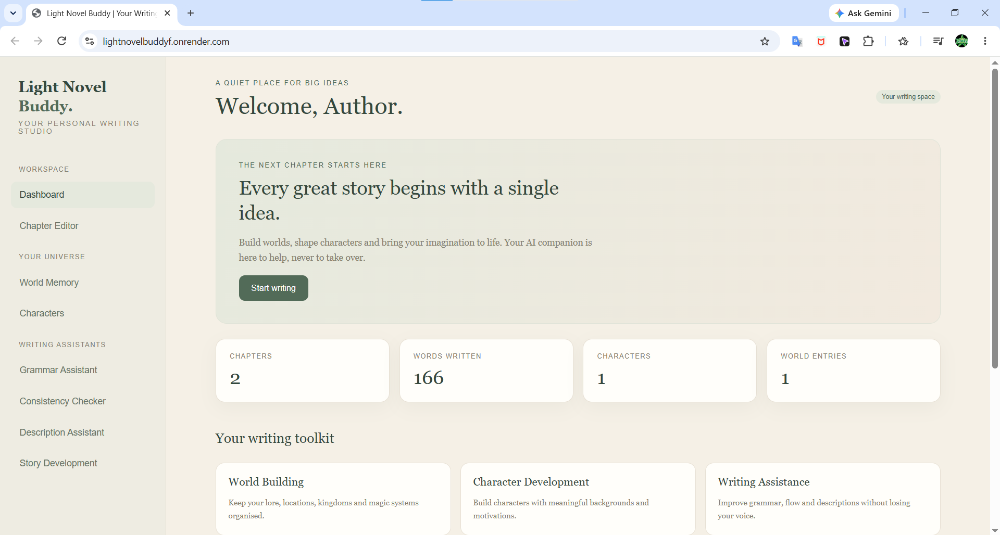
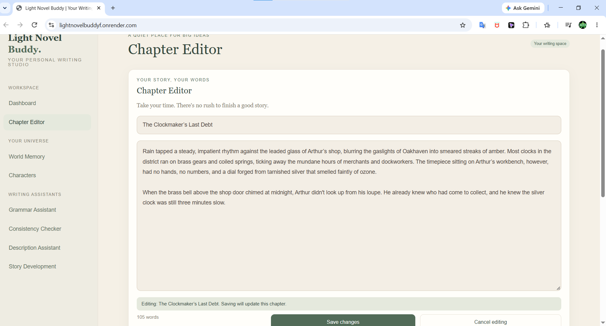
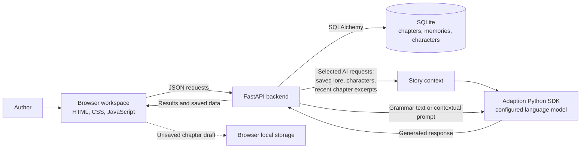
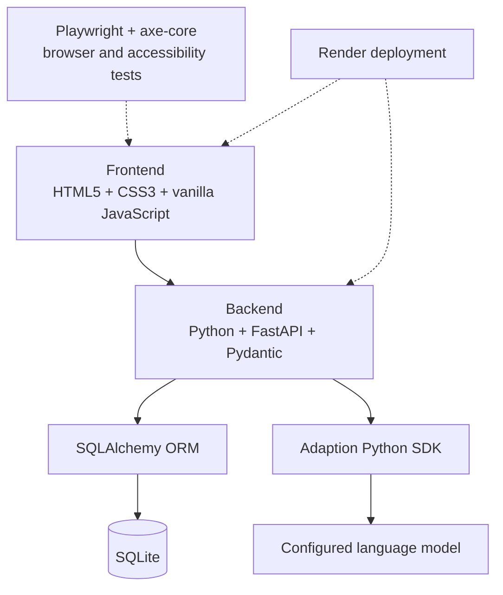

<div align="center">

# Light Novel Buddy

### Your story. Your choices. Your world.

A personal writing studio for building fictional worlds, developing characters, and exploring stories with AI assistance.<br>
Built to support the author’s imagination—not take it over.

[](https://lightnovelbuddyf.onrender.com/)
[](https://lightnovelbuddy.onrender.com/)
[](https://www.youtube.com/watch?v=BRy7R7-objw)


[](https://pypi.org/project/adaption/)
[](#license)

**Team:** Hackholics  |  **Track:** Track-1: Storytelling & Co-writers<br>
**The problem:** Writers need a way to keep growing fictional worlds coherent without giving up their creative voice.

</div>

---

## Table of contents

- [The problem](#the-problem)
- [About the project](#about-the-project)
- [Original vision vs. current implementation](#original-vision-vs-current-implementation)
- [Key features and screenshots](#key-features-and-screenshots)
- [How this fits the 50% MVP milestone](#how-this-fits-the-50-mvp-milestone)
- [System architecture](#system-architecture)
- [Adaption AI integration](#adaption-ai-integration)
- [Technology stack](#technology-stack)
- [Repository structure](#repository-structure)
- [Getting started](#getting-started)
- [Testing](#testing)
- [Roadmap: 21 November](#roadmap-21-november)
- [Impact](#impact)
- [Meet Hackholics](#meet-hackholics)
- [License](#license)

## The problem

A long-running novel can hold hundreds of details: a character’s motivation, a promise made in an early chapter, the geography of a city, or the rules behind a magical ability. As the story grows, those details are easy to lose across drafts, notes, and separate writing tools. Revising prose and finding the next direction can become just as demanding as keeping the world consistent.

Generic writing tools may help polish a paragraph but lack the story context that makes a suggestion useful. At the same time, authors should not have to hand creative control to an AI. They need a companion that helps them **organise, review, and brainstorm**, while leaving the final decisions to them.

## About the project

**Light Novel Buddy** brings a chapter editor, a world-building notebook, a character library, and AI writing assistants into one calm workspace. Authors can record the foundations of their universe, work on chapters, and ask for help with grammar, continuity, description, plot possibilities, and character development.

The project fits the **Wildcard — Open Innovation** track through its focus on an artistic, real-world problem: helping storytellers manage narrative complexity and explore creative possibilities. It follows a simple principle: **AI suggests; the author decides.**

> **Current stage:** This repository represents our working 50% MVP, not the completed product. It uses a single shared default novel and SQLite. Authentication, per-user privacy, automatic knowledge extraction, and other planned capabilities are not yet implemented.

## Original vision vs. current implementation

The original concept is our destination; the MVP establishes a practical foundation. The table below separates what exists today from what still needs to be built.

| Area | Original vision | Implemented in the 50% MVP | Still to explore |
| --- | --- | --- | --- |
| **World-building memory** | A growing, AI-powered database of lore, rules, places, relationships, and events. | Authors manually add, edit, and delete categorised entries; saved entries can be sent as context to several assistants. | Automatic extraction from uploaded chapters and automatic world-database updates. |
| **Grammar and writing correction** | Writing feedback that preserves the author’s voice, with granular control over corrections. | An AI review returns a revised passage and a short list of important corrections; the author chooses a style. | Individual accept/reject controls for each correction and a more structured editing workflow. |
| **Story consistency** | Detect contradictions and connect them to established narrative evidence. | An AI assistant compares submitted text with saved lore, character profiles, and excerpts from recent chapters, and is instructed to explain possible conflicts. | Guaranteed or structured chapter references, broader chapter coverage, and richer timeline/location tracking. |
| **Description and world enrichment** | More immersive environments, characters, abilities, atmosphere, and action. | The author submits a description and selects a desired style; the AI receives available story context and suggests an enriched version. | More targeted, fine-grained controls and deeper world-aware editing. |
| **Interactive story development** | Explore choices and follow-up possibilities without surrendering authorship. | Given a situation and an optional author idea, the assistant is prompted to suggest four possible directions. | An interactive multiple-choice/follow-up flow that builds on selected or combined ideas. |
| **Character development** | Track believable growth, relationships, motivations, and arcs over time. | Authors manage character profiles and request contextual AI analysis of a character. | Dedicated arc tracking and a visual, evolving relationship web. |

AI suggestions are generated responses, not guaranteed facts. Authors should review them against their own notes and manuscript.

## Key features and screenshots

> Screenshots show the shared 50% MVP demonstration; some controls may differ slightly as the project evolves.

### 1. A dashboard for the whole story



The dashboard brings the workspace together. It displays the current number of chapters, words, characters, and world entries, along with recently written chapters and a quick path into the editor. It is designed to make a growing project feel approachable rather than overwhelming.

A word-count goal card lets you set a target between 100 and 1,000,000 words. The bar fills as you save chapters, reports how many words remain, and switches to a completed state once the goal is passed. The goal is stored in the browser, so it is per-browser rather than per-account.

### 2. Chapter editor and draft recovery



- Write and title chapters with a live word count; save, view, edit, and delete saved chapters.
- Recover an unsaved chapter draft from the same browser after a reload, and receive a warning before replacing unsaved work.
- Keep newer typing if it is entered while a save is in progress; prevent repeated submissions while that save is pending.
- Read saved chapters in a keyboard-accessible viewer, and jump from the viewer straight into editing that chapter.
- Save with **Ctrl/Cmd + S**. On the assistant pages, **Ctrl/Cmd + Enter** runs the assistant. Both shortcuts are listed in the editor.

**Exports:** *Export manuscript* downloads every saved chapter, oldest first, as a single Markdown file with a word count and chapter separators. *Export story bible* downloads the world entries (grouped by category), character profiles, and a chapter index as one reference document. Both are generated in the browser from data the API already returns; nothing extra is stored on the server.

**Draft limitation:** Recovery is stored in the browser's local storage, not synced across devices. Clearing browser data can remove it, and tabs in the same browser share one draft slot. A saved chapter is stored in the backend database; a local draft is not a backup of that database.

### 3. World-building memory


Build a reference library for the details that make a universe feel real. Add a name, category, and description for locations, kingdoms, magic systems, organisations, history, abilities, and other lore. Entries can be edited or deleted as the story changes.

Authors can use these descriptions to record **where the story takes place**, from a single town to an entire fictional realm; **when it takes place**, including important historical events and their order; and **what kind of story it is**, such as a fantasy adventure, mystery, or romance. Keeping those details together gives the author a reference for the setting, timeline, and narrative direction as the world grows.

The consistency, description, story development, and character assistants can use these saved entries as part of their prompts. Adding information is currently **manual**: timelines and story types are written in entry descriptions rather than tracked in dedicated fields, and chapters are not automatically mined for new facts.

### 4. Character library and development assistant


Create, update, and remove character profiles with names, personalities, backgrounds, and other details. Authors can use the profile description to explain **who a character is, the significant role they play in the story, and how they connect to other characters or events**. These details help keep the cast clear as the narrative grows and can give interested readers more context about the overall story when the author shares them.

Within the current shared workspace, anyone viewing the Character Library can read the saved profiles; there is not yet a separate reader-facing page or a dedicated field for a character's story role. The character development assistant also accepts a character description or situation and asks the AI to consider motivations, strengths, weaknesses, relationships, behaviour, and growth opportunities against the available story context.

The assistant offers ideas for the author to review; it does not automatically maintain a relationship graph or an independently tracked character arc.

### 5. AI writing toolkit

| Assistant | What the current MVP does |
| --- | --- |
| **Grammar and Writing** | Reviews submitted prose for grammar, spelling, punctuation, readability, dialogue, and flow. Choose natural, formal, descriptive, or simple style. |
| **Story Consistency** | Sends a submitted passage alongside available saved context and asks the AI to identify possible contradictions and suggest corrections. Saved entries are tagged (`W` world, `C` character, `CH` chapter) so the AI can cite which one it used; resolved citations appear above the response as source chips. |
| **Descriptive Writing** | Suggests a richer version of a submitted description using a selected style and available world context. |
| **Story Development** | Explores four potential next directions from a situation and an optional idea supplied by the author. |
| **Character Development** | Analyses a submitted character and suggests ways to develop them using available story context. |

The tools display responses for the author to consider; they do not automatically overwrite saved chapters. Every response has **Copy** and **Insert into editor** actions: inserting appends the suggestion to the current draft as unsaved text, so nothing reaches the database until you save the chapter. The interface also includes a collapsible mobile menu, labelled form controls, and a chapter viewer that can be closed with Escape.

## How this fits the 50% MVP milestone

This submission demonstrates an **end-to-end foundation** rather than a collection of disconnected concepts:

1. **Create:** write and save a chapter.
2. **Remember:** manually record world details and character profiles.
3. **Assist:** send an excerpt or idea to a purpose-specific AI tool.
4. **Review:** use the response as inspiration or feedback while retaining the author’s final choice.

The 50% label describes our team’s current project milestone, not a claim that every feature in the original vision is half-complete. The [roadmap](#roadmap-21-november) identifies the major work still ahead.

## System architecture



**Reference tags:** for the consistency checker only, each saved block in the prompt is prefixed with a stable tag (`[W12]`, `[C3]`, `[CH5]`). The model is asked to cite the tag behind each issue. The backend then resolves those tags against the records it actually sent and returns only matches, so an invented tag such as `[W999]` is dropped rather than shown as a source. If the model cites nothing, the response renders exactly as before. The other four assistants still receive unlabelled context, and their responses keep the original `{ "result": ... }` shape.

**Context boundaries:** The consistency, description, story-development, and character assistants collect all saved world entries and character profiles for the selected novel, plus up to the 10 most recent chapters (the last 2,500 characters of each). The grammar assistant sends the text and requested style without this world-context bundle. The current interface uses the default novel; it does not provide multi-novel selection.

## Adaption AI integration

[Adaption’s Python SDK](https://pypi.org/project/adaption/) is the connection between the writing tools and the language model. As the hackathon’s AI sponsor, Adaption helps power the prototype’s central interaction: turning an author’s request and, where applicable, their saved story context into a response they can evaluate.

1. The browser sends the author’s text and selected options to a FastAPI AI endpoint.
2. For context-aware tools, the backend gathers relevant saved world and character records and recent chapter excerpts from SQLite.
3. The backend builds feature-specific instructions and calls `Adaption(...).responses.create(...)` with the configured model.
4. The response text is returned to the interface for the author to review.

The API key is read **on the backend** from `ADAPTION_API_KEY`; it is not embedded in the frontend. `ADAPTION_MODEL` is optional and defaults to `qwen3.5-397b`. A valid key and access to the configured model are required for live AI requests.

> **Privacy:** AI requests send the submitted text—and, for context-aware tools, the collected story context—to the external AI provider. The current app has no user authentication or per-user isolation. Do not treat the shared MVP as a private manuscript vault or submit sensitive writing until those protections are in place.

## Technology stack



| Layer | Technology | Role |
| --- | --- | --- |
| Frontend | HTML, CSS, vanilla JavaScript | Workspace, forms, navigation, local draft recovery, and API requests. |
| API | Python, FastAPI, Pydantic, Uvicorn | HTTP routes, request models, and the application server. |
| Persistence | SQLAlchemy and **SQLite** | Store the default novel, chapters, world memories, and character profiles. |
| AI | Adaption Python SDK | Send writing-assistant requests to the configured model. |
| Testing | Playwright and axe-core | Browser workflow and automated accessibility checks with a mocked API. |
| Deployment | Render | Hosts the linked frontend and backend services. |

## Repository structure

```text
LightNovelBuddy/
├── index.html                 # Single-page writing workspace
├── style.css                  # Layout, styling, responsive and accessibility styles
├── script.js                  # Navigation, API calls, editor and assistant workflows
├── backend/
│   ├── main.py                # FastAPI routes, SQLAlchemy models and AI integration
│   ├── requirements.txt       # Python dependencies
│   └── .env                   # Tracked placeholder configuration; never add a real key
├── screenshots/
│   ├── dashboard.png
│   ├── chapter-editor.png
│   ├── world-memory.png
│   └── character-development.png
├── tests/
│   ├── app.spec.cjs           # Browser and accessibility tests with mocked API
│   ├── serve.cjs              # Test-only frontend server
│   └── README.md              # Test setup notes
├── package.json               # Browser-test dependencies and npm test command
├── package-lock.json          # Locked Node.js dependency tree
├── playwright.config.cjs      # Browser-test configuration
├── .gitignore
└── README.md
```

At backend startup, the app creates its tables and a default novel if needed. Its SQLite file is created at `backend/database.db` and is ignored by Git. Whether that file survives a hosting restart or redeployment depends on the deployment’s persistent-storage configuration; backups are not implemented here.

## Getting started

### Prerequisites

- Python 3.9+ and `pip`.
- A modern web browser.
- An Adaption API key with access to the configured model for live AI features.
- Node.js and npm only if you want to run the browser tests.

### 1. Clone and install the backend

```bash
git clone https://github.com/ramrounakmukherjee-blip/LightNovelBuddy.git
cd LightNovelBuddy

python -m venv .venv
source .venv/bin/activate                 # Windows: .venv\Scripts\activate
python -m pip install -r backend/requirements.txt
```

### 2. Configure Adaption safely

The repository currently tracks a `backend/.env` **placeholder**. Git continues to track a file even if it matches `.gitignore`, so **do not replace that placeholder with a real key and commit it**. For local development, set the key as an environment variable instead. For example, in Bash:

```bash
read -rsp "Adaption API key: " ADAPTION_API_KEY; echo
export ADAPTION_API_KEY
# Optional: export ADAPTION_MODEL="qwen3.5-397b"
```

The backend’s `load_dotenv` does not overwrite an already-set environment variable. Configure deployment secrets through the hosting provider’s environment settings rather than committing them. If a real key is ever committed, revoke and rotate it.

### 3. Start the backend

From the repository root, with the virtual environment activated:

```bash
python -m uvicorn backend.main:app --host 127.0.0.1 --port 8000
```

Visit `http://127.0.0.1:8000/api/health` for the health response or `http://127.0.0.1:8000/docs` for FastAPI’s interactive API documentation. The health response reports whether the key environment variable is non-empty; it does **not** verify that the key or model works.

### 4. Point the local frontend at the local backend

**Important:** with no override, the frontend talks to the deployed Render API, so running it unchanged can read or modify the deployed shared database. `config.js` resolves the API base at load time, so you never edit `script.js`.

Highest priority wins:

1. `?api=` query parameter — `http://127.0.0.1:5500/?api=http://127.0.0.1:8000`
2. `window.LNB_API` in a local `config.local.js` (git-ignored, optional):

   ```javascript
   window.LNB_API = "http://127.0.0.1:8000";
   ```
3. `localStorage.setItem("lnb_api_base", "http://127.0.0.1:8000")` — or, from the browser console:

   ```javascript
   LNB_CONFIG.setApiBase("http://127.0.0.1:8000"); // clear with LNB_CONFIG.setApiBase(null)
   ```
4. The deployed URL, used when nothing else is set.

Invalid values (non-http/https, not a URL) are ignored, so a typo cannot brick the app. `LNB_CONFIG.isLocalOverride` reports whether an override is active.

In another terminal from the repository root, serve the frontend:

```bash
python -m http.server 5500 --bind 127.0.0.1
```

Open `http://127.0.0.1:5500/?api=http://127.0.0.1:8000`. That origin is in the backend's default CORS allowlist. The browser tests mock the **deployed API URL**, which stays the default, so no file edit is needed before running them.

### 5. Configuration reference

| Variable | Where | Default | Purpose |
| --- | --- | --- | --- |
| `ADAPTION_API_KEY` | backend env | none | Required for live AI. Never commit a real key. |
| `ADAPTION_MODEL` | backend env | `qwen3.5-397b` | Model used for AI requests. |
| `DATABASE_URL` | backend env | `sqlite:///backend/database.db` | Any SQLAlchemy URL. `postgres://` is rewritten to `postgresql://`. Set `DATABASE_URL` only where the database is durable. |
| `ALLOWED_ORIGINS` | backend env | local 5500 + deployed frontend | Comma-separated CORS allowlist; replaces the defaults. |
| `JWT_SECRET_KEY` | backend env | random per process | Only used once authentication is wired in; a random fallback invalidates tokens on restart. |
| `LNB_API` / `lnb_api_base` | frontend | deployed API | Local API override, see step 4. |

**Deployment notes (Render):** set the variables above in the service's Environment tab, not in `backend/.env`. A free Render web service has an ephemeral filesystem, so the default SQLite file is recreated on every deploy or restart. Do not point `DATABASE_URL` at a database you are not ready to keep: tables are created at startup with `create_all`, and there are no migrations or backups yet.

## Testing

```bash
npm ci
npx playwright install chromium
npm test
```

Some systems may also need Playwright’s browser system dependencies; see [Playwright’s installation documentation](https://playwright.dev/docs/intro). The tests cover draft recovery, save behaviour, edit flows, keyboard access, mobile navigation, and automated accessibility checks. They intercept API requests with an in-memory mock: **they do not test the live backend, database durability, or real Adaption responses**. See [`tests/README.md`](tests/README.md) for the test-specific setup.

## Roadmap: 21 November

If Hackholics is selected for the offline hackathon, these are our proposed next steps. Scope and priorities may change; none of the items below should be read as already shipped.

### Major features

- **User sign-in and data privacy:** introduce authentication, verify identity on the backend, and enforce ownership for every novel, chapter, world entry, character, and AI request. Define how existing shared data is handled and add protections against AI-request abuse.
- **Novel selection:** allow an author to create and switch between multiple novels, with chapters, memories, characters, and AI context scoped to the selected work.
- **Narrative DNA:** explore an author-controlled writing-style profile covering tone, pacing, vocabulary, dialogue, and descriptive habits so suggestions can better reflect the author’s voice.
- **Chekhov’s Gun Tracker:** record potentially meaningful objects, promises, conversations, and events so authors can revisit unresolved threads later in the story.
- **Character Relationship Web:** visualise friendships, rivalries, alliances, secrets, betrayals, and changes in relationships as a narrative grows.

### Minor features and refinements

- Explore automatic extraction of world information from chapters, with author review before updates are accepted.
- Add individual accept/reject controls for writing corrections, and clearer references for consistency feedback. **References done in this branch:** consistency responses now cite tagged saved entries and render resolved source chips; per-correction accept/reject remains future work.
- Develop more interactive story brainstorming, including follow-up questions and ways to combine directions.
- Improve draft recovery across tabs and, after sign-in is in place, explore safe cross-device draft sync.
- ~~Improve local API configuration so developers do not need to edit a hard-coded URL, and document deployment and environment setup more clearly.~~ **Done in this branch:** `config.js` resolves the API base (query parameter, local override file, or browser storage), and the README documents environment variables and Render deployment. PostgreSQL support remains future work.

### Small bug fixes and hardening

- Strengthen **server-side validation**, including blank input and invalid or null update handling.
- Handle save and network failures more robustly, including safe retries where a response is lost after a server has saved data.
- Continue testing mobile layouts, accessibility, edge cases, and error messages across the writing workflows.

### A better database: moving beyond SQLite

SQLite is a useful, lightweight starting point for the current prototype. For authenticated users and a more durable deployment, we plan to evaluate a managed relational database such as **PostgreSQL**:

1. Configure the backend using an environment-provided database URL rather than a fixed local file.
2. Introduce schema migrations and add user/novel ownership relationships.
3. Migrate existing records deliberately, preserving or assigning ownership only after a migration policy is agreed.
4. Enforce access checks in the API and configure durable storage, backups, and recovery procedures.
5. Test the migration and restore process before relying on it for authors’ manuscripts.

This is a proposed direction, not an existing PostgreSQL integration or a promise of a completed migration on the day.

## Impact

### Impact of the 50% MVP

The prototype gives writers a single place to draft chapters, organise story details, and try context-aware assistance. It demonstrates how even a manually maintained world memory can make brainstorming and consistency review more useful while keeping decisions with the author. This is the intended benefit of the prototype; we have not yet measured user outcomes.

### Impact we hope the complete MVP can have

With stronger privacy, durable per-user storage, richer story memory, and author-controlled creative tools, Light Novel Buddy could help writers spend less time searching through scattered notes and more time creating coherent, distinctive stories. Our aim is to make narrative support more accessible without replacing the human imagination at its centre.

## Meet Hackholics

| Team member | GitHub |
| --- | --- |
| **Ram Rounak Mukherjee** | [@ramrounakmukherjee-blip](https://github.com/ramrounakmukherjee-blip) |
| **Atreyee Mondal** | [@atreyee09mondal-dot](https://github.com/atreyee09mondal-dot) |
| **Anik Mitra** — the original proposer of the Light Novel Buddy idea | [@anikm112128-stack](https://github.com/anikm112128-stack) |
| **Agniv Roy** | [@fsgfh](https://github.com/fsgfh) |

Anik’s original idea gave this project its first spark; together, Hackholics is building it into a companion for storytellers.

## License

No license file has been added to this repository yet. The team has not specified an open-source license; please contact the project owners before assuming permission to reuse or redistribute the code.

---

<div align="center">

**Made for storytellers, by storytellers.**<br>
*Your story. Your choices. Your world.*

</div>
